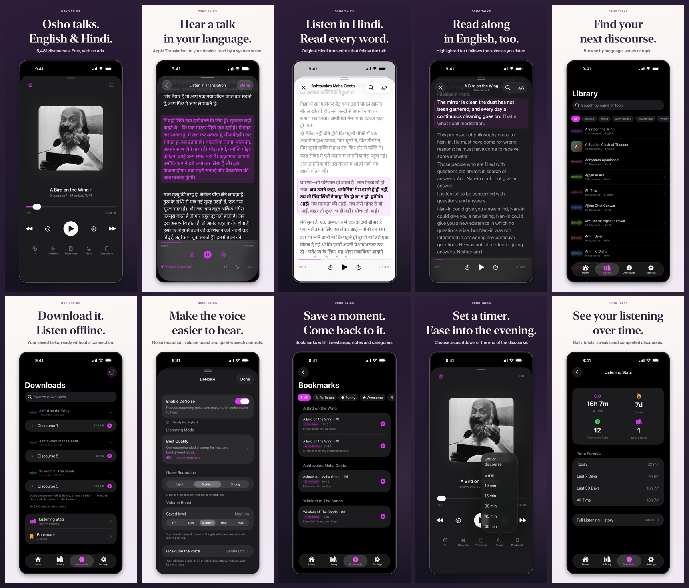
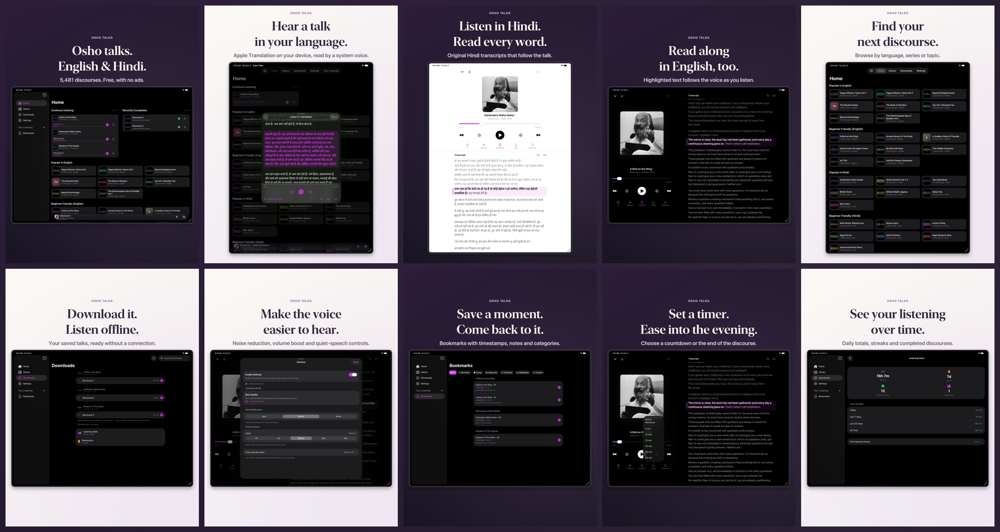

# 1.17.0 screenshots

The 1.16.1 set plus one new slide in second place for listening in translation, with
the order and captions in [`story.json`](../../../../Tools/StoreAssets/story.json).
Uploaded to the 1.17.0 draft on 2026-10-17. The iPhone, iPad and Watch sets read back
`COMPLETE`, with the count, order and MD5 checksums in `manifest.json`
([readback](upload-readback.json)).



<details>
<summary>iPad gallery</summary>



</details>

| Set | Images | Source builds |
| --- | ---: | --- |
| iPhone 6.9" (`APP_IPHONE_67`) | 10 | 1.15.0 (26); `02-translation` from 1.17.0 (35) |
| iPad 13" (`APP_IPAD_PRO_3GEN_129`) | 10 | 1.16.0 (28), 1.16.1 (29); `02-translation` from 1.17.0 (35) |
| Apple Watch | 5 | 1.16.0 (28), unchanged |

## The translation slide

"Hear a talk in your language." with "Apple Translation on your device, read by a
system voice." Both captures show the read-along of A Bird on the Wing #1 in Hindi,
playing, with Lekha at Osho's pace:

- `raw/iphone/translation.png`: **Osho Store iPhone 1.17** (iPhone 17 Pro Max, iOS 27.0),
  the "I am here only to be a midwife" passage highlighted.
- `raw/ipad/translation.png`: **Osho Store iPad 1.17** (iPad Pro 13-inch M5, iOS 27.0),
  portrait. The Listen in Translation sheet sits over the iPad Home, whose Continue
  Listening row and mini-player show "Discourse 1 · Hindi translation".

The simulator can't run Apple Translation (preparation fails at `checkingSupport`), so
[`seed-narration.py`](../../../../Tools/StoreAssets/seed-narration.py) built the saved
translation on the Mac (macOS 26.7.1). It runs the app's own `NarrationService`,
`AppleNarrationTranslator` (high fidelity, installed en → hi) and
`NativeNarrationSpeechRenderer` with the pause pacer on the real transcript the app
fetched in the simulator: 93 passages, 97:46 of audio, voice
`com.apple.voice.super-compact.hi-IN.Lekha`. The script copies that cache and the
transcript into the simulators; the app UI, playback and highlighting are real.
Rendition `e3997c85…` and its audio stay in ignored `build/store-narration/`.

```bash
python3 Tools/StoreAssets/seed-narration.py \
  --transcript build/store-narration/english-A_Bird_on_the_Wing__-1.json \
  --udid "$PHONE" --udid "$IPAD"
xcrun simctl launch "$DEVICE" com.agraabhi.oshodiscourses \
  -debugNarration english-A_Bird_on_the_Wing__-1 -settings.appearance dark \
  -settings.accentTheme purple -settings.dailyAccentShuffle 0 -settings.transcriptFontSize 21
```

Then tap Play, then Read along, tap a passage and tap Follow playback. AXe 1.8.0 could
tap and swipe on iOS 27, but `describe-ui` returned an empty or failed tree, so the
taps used coordinates checked against screenshots.

## Render and upload

```bash
swift Tools/StoreAssets/render.swift 1.17.0 --allow-mixed-builds
asc --profile personal --strict-auth screenshots upload \
  --version-localization e3e22dcc-0140-4fde-bebe-fe9826cb4f91 \
  --path docs/app-store/screenshots/1.17.0/iphone --device-type IPHONE_69 --skip-existing
```

The iPad set used the same command with `ipad` and `IPAD_PRO_3GEN_129`. The other nine
images in each set rendered byte-identical to 1.16.1, so `--skip-existing` uploaded only
`02-translation.png` and put it second. Those nine keep their 1.16.1 file names in App
Store Connect (for example `02-hindi.png` is third); the checksums are what match. en-GB
and hi have no sets of their own and use en-US, as before. Nothing was submitted.
